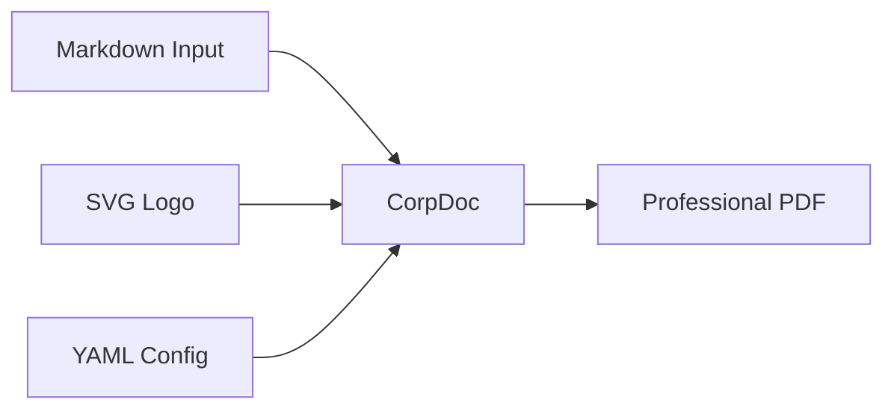
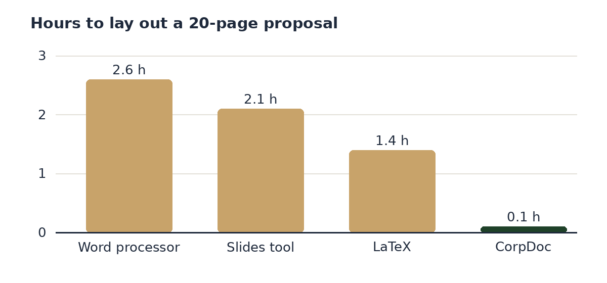

# Welcome to CorpDoc

**CorpDoc** turns plain Markdown into professional corporate PDFs with zero
manual layout work. This document demonstrates every feature.

## What CorpDoc does

- Extracts **brand colors** automatically from your SVG logo
- Generates a branded **cover page** with title and subtitle
- Adds a **version history** page for document control
- Builds an **automatic table of contents**
- Renders **headers and footers** on every page with your company info
- Formats **tables** with zebra striping in your brand colors
- Supports **nested lists** (three levels) and **numbered lists**
- Embeds **images** (PNG, JPG, SVG) with captions
- Keeps **links** clickable
- Renders **Mermaid diagrams** locally when the Mermaid CLI is installed
- Detects the **document language** automatically

---

# 1. Text Formatting

CorpDoc supports inline markdown: **bold text**, *italic text*, ***bold italic***,
and `inline code`. Paragraphs are justified and use a professional serif-free
font stack for readability.

## 1.1 Bullet Lists

Simple bullet lists:

- First item
- Second item
- Third item

Nested lists (use 2-space indent for sub-items):

- **Phase 1: Planning**
  - Requirements gathering
  - Stakeholder interviews
  - Initial design mockups
- **Phase 2: Development**
  - Backend implementation
  - Frontend integration
  - Automated testing
- **Phase 3: Deployment**
  - Staging rollout
  - Production deployment
  - Post-launch monitoring

Lists nest up to three levels, each with its own indent:

- Deliverables
  - Documentation
    - Operator manual
    - Maintenance plan
  - Training
    - On-site workshop

## 1.2 Numbered Lists

Ordered lists keep their numbers. Each nested list restarts at 1, and a list may start at any number:

1. Sign the proposal
2. Kick-off meeting
   1. Agree on scope
   2. Name the contacts on both sides
3. First delivery

Continuing the count after the paragraph above:

4. Review round
5. Final delivery

Bullets and numbers can be mixed:

1. Hardware
   - Inverter
   - Mounting system
2. Services
   - Commissioning

## 1.3 Links

Links stay clickable in the PDF: see the [CorpDoc repository](https://github.com/RoCCoCo13/corpdoc), the [configuration reference](https://github.com/RoCCoCo13/corpdoc/blob/main/docs/configuration.md), or write to [hello@example.com](mailto:hello@example.com).

## 1.4 Headings Hierarchy

The document supports four heading levels (H1 through H4), each styled
in the brand colors with appropriate spacing.

### This is an H3

Used for sub-sections within a main chapter.

#### This is an H4

Used for fine-grained subdivisions.

---

# 2. Tables

Tables are automatically styled with brand colors. The header row uses the
primary color, and even rows get a subtle tint of the accent color.

## 2.1 Simple Table

| Feature | Status | Priority |
|---------|--------|----------|
| Cover page | ✓ Done | High |
| Version history | ✓ Done | High |
| Auto TOC | ✓ Done | High |
| Nested lists | ✓ Done | Medium |
| Numbered lists | ✓ Done | Medium |
| Images | ✓ Done | Medium |
| Unicode fonts | ✓ Opt-in | Medium |
| Mermaid diagrams | ✓ Local | Medium |
| Multi-language | ✓ Done | Low |

## 2.2 Wider Table (6+ columns)

| Phase | Duration | Team | Budget | Status | Risk |
|-------|----------|------|--------|--------|------|
| Planning | 2 weeks | 3 | €5,000 | Done | Low |
| Design | 3 weeks | 5 | €12,000 | Done | Medium |
| Development | 8 weeks | 8 | €45,000 | In Progress | Medium |
| Testing | 2 weeks | 4 | €8,000 | Pending | Low |
| Deployment | 1 week | 2 | €3,000 | Pending | High |

## 2.3 Very Wide Table — Auto Landscape

When a table has 8 or more columns, CorpDoc automatically rotates the page to
landscape so the content stays readable. The threshold is configurable via
`tables.landscape_threshold` in the YAML.

| Phase | Duration | Team | Personnel | Materials | Software | Travel | Overhead | Total |
|-------|----------|------|-----------|-----------|----------|--------|----------|-------|
| Planning | 2 weeks | 3 | €4,200 | €150 | €0 | €300 | €350 | €5,000 |
| Design | 3 weeks | 5 | €9,800 | €600 | €900 | €0 | €700 | €12,000 |
| Development | 8 weeks | 8 | €36,000 | €1,100 | €4,200 | €800 | €2,900 | €45,000 |
| Integration | 2 weeks | 6 | €7,400 | €300 | €0 | €0 | €800 | €8,500 |
| Testing | 2 weeks | 4 | €6,500 | €200 | €700 | €100 | €500 | €8,000 |
| Deployment | 1 week | 2 | €2,400 | €100 | €200 | €100 | €200 | €3,000 |
| Training | 1 week | 3 | €3,100 | €250 | €0 | €400 | €250 | €4,000 |
| Handover | 1 week | 2 | €1,800 | €0 | €0 | €0 | €200 | €2,000 |

---

# 3. Diagrams

Mermaid diagrams are rendered on your own machine when the Mermaid CLI (`mmdc`) is installed; the diagram source is never sent to an online service. Without `mmdc`, the source is shown instead as a styled block in the brand colors.



---

# 4. Images

A paragraph that contains only an image becomes a figure. It is scaled down to the text width when needed (never enlarged), keeps its proportions, and shows its alt text as a caption. Paths are relative to the Markdown file.



Vector graphics stay sharp at any zoom level:


---

# 5. Formulas and Symbols

This sample enables the bundled DejaVu fonts (`fonts.family: "dejavu"` in `corpdoc.yml`), so mathematical symbols, Greek letters, arrows, superscripts and subscripts can be written directly as Unicode text:

- Energy: E = mc², and for a photon E = hν
- Totals and bounds: Σ xᵢ ≤ 100, with η ≥ 0.92 and Δt → 0
- Chemistry: 2 H₂ + O₂ → 2 H₂O, and CO₂ emissions in kg/m²

The same symbols work in tables and code:

| Quantity | Symbol | Constraint |
|----------|--------|------------|
| Efficiency | η | 0.92 ≤ η ≤ 0.98 |
| Temperature rise | ΔT | ΔT ≤ 40 °C |
| Annual yield | Σ Eₙ | ≥ 75 MWh |

Longer formulas read best in a code block, where spacing is preserved:

```
P_loss = I² · R
η      = P_out / P_in ≥ 0.92
E_year = Σ (P_n · h_n),  n = 1 … 12
```

With the default fonts (no `fonts` setting), keep to plain text in code blocks, for example `CO2` and `<=`. CorpDoc prints a warning when a document contains characters the built-in fonts cannot show.

---

# 6. How It Works

CorpDoc is a small, focused Python package. The pipeline is intentionally
simple:

1. Read the Markdown input file
2. Parse YAML frontmatter and body blocks
3. Extract brand colors from the SVG logo
4. Generate the cover page with accent color block
5. Render the version history page
6. Build the automatic table of contents
7. Emit the body content with styled elements
8. Apply header and footer to every content page
9. Write the final PDF

---

# 7. Configuration

All branding is defined in a single `corpdoc.yml` file. Once set up, the same
configuration can be reused for every document your company produces.

The config controls the company name, tagline, logo paths, footer fields, font family, and which front pages (cover, version history, table of contents) are included. The color palette is derived automatically from the logo.

A document can set a page budget with `max_pages`; CorpDoc reports the page count after every render and warns when the body runs over.

---

# 8. Next Steps

Visit [github.com/RoCCoCo13/corpdoc](https://github.com/RoCCoCo13/corpdoc) for the full documentation, more examples, and installation instructions.

Contributions are welcome!
